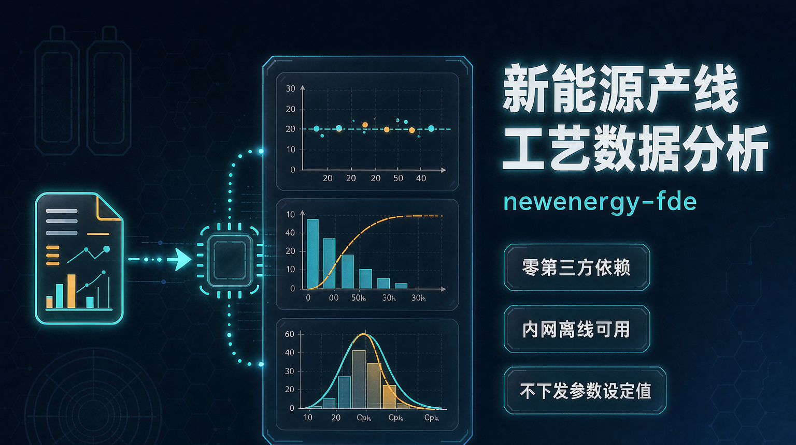

# newenergy-fde —— 新能源产线工艺数据分析 Skill

面向**锂电池 / 光伏工艺工程师**的产线数据分析技能包。

上传检测设备导出的 CSV/Excel，自动完成工序判定 → 数据清洗 → SPC 判异 →

相关性分析 → 不良 Pareto → 根因定位 → DOE 寻优 → 标准化报告。




> **许可一句话**：Elastic License 2.0，**源码可得（source-available），不是 OSI 开源**。
> 个人与企业内部自用免费；对外提供托管服务需商业授权。详见[第 0 节](#0-先说清楚许可这不是开源项目)。

---

## 30 秒跑通

```bash
git clone https://github.com/kinart-hub/newenergy-fde.git
cd newenergy-fde

python scripts/selftest.py          # 279 项端到端自检，应全部通过
python scripts/fde_run.py analyze -i examples/01_涂布工艺数据.csv -o output/try
```

跑完看 `output/try/`：工艺分析报告、8D 初稿（D1–D8）、图表、结构化 `result.json`。
**不需要 `pip install` 任何东西**——全部用 Python 标准库实现，内网离线可用。

## 三种用法

| 形态 | 怎么用 | 适合谁 |
| --- | --- | --- |
| **AI Skill**（推荐） | 装进支持 Skill 的 AI 客户端，直接说"分析这份涂布数据" | 不想碰命令行的工艺/质量工程师 |
| **命令行** | `python scripts/fde_run.py analyze -i <数据> -o <输出>` | 要批量跑、要接定时任务的场景 |
| **编程集成** | 调用 `lib/pipeline.py` | 集成进自有系统（**对外提供服务需商业授权**） |

---

## 0. 先说清楚许可（这不是开源项目）

本项目采用 **Elastic License 2.0**，条款见 `LICENSE`，
原文以 https://www.elastic.co/licensing/elastic-license 为准。

**它是"源码可得"（source-available），不是 OSI 认证的开源许可证。**
本仓库不自称开源，也请不要这样介绍它。

| 你可以免费做                                        | 你不可以做                                    |
| --------------------------------------------- | ---------------------------------------- |
| 下载、运行、修改，用于自己的工艺分析工作（**允许企业内部商业使用**）          | 做成对外提供的托管服务 / 平台服务再售                     |
| 修复 bug、添加自家工序与参数，只要保留许可条款                    | 移动、修改、禁用或**规避其中的许可密钥功能**，或移除受其保护的功能      |
| 把修改后的版本分发给**组织内部**同事使用                        | 删除或掩盖许可、版权声明；商标使用另受适用法律规定                |
| 写文章、做教学、二次开发自用                                | 删除许可后再分发（违反条款的使用不属于被许可行为，且许可会自动终止）        |

需要上表中"不可以"的用法（包括对外提供服务）时，请联系版权持有人获取商业许可。

> 为什么不选 Apache-2.0 / MIT：宽松许可证授予的是永久且不可撤销的权利。
> 一旦公开发布，任何人都可以删掉其中的授权校验代码后合法再分发，
> 那样这个项目就没有可持续的资金去继续演进。选择 Elastic License 2.0，
> 是为了让"同行继续免费自用与贡献"和"项目能长期演进"同时成立。

贡献前请读 [`CONTRIBUTING.md`](./CONTRIBUTING.md) 与 [`CLA.md`](./CLA.md)——
**第一个 PR 之前必须签 CLA**，否则贡献者对自己的部分保留版权，
将来整个项目无法统一变更许可。

---

## 1. 它解决什么问题

| 现状痛点                | 本 Skill 的做法                                    |
| ------------------- | ---------------------------------------------- |
| 产线数据躺在 Excel 里，没人分析 | 上传即出报告，无需写公式                                   |
| 不良率升高，靠经验猜原因        | 分层（设备/批次/班次）先收窄边界，再用统计 + 机理定位                  |
| 8D 的 D4 根因写不出证据     | 给出相关系数、p 值、分层 ANOVA、5Why 链条                    |
| 参数优化靠试错             | 自动生成正交表/响应面运行表，含因子水平取值依据                       |
| 每家 MES 列名都不一样       | 116 个标准参数的别名库 + 工序上下文匹配，认不出来的字段可手工补别名入库        |
| 不同检测设备导出格式互不兼容      | 设备档案层：竖表/多级表头/合计尾行归一 + 私有列名映射 + 单位自动换算，见第 5c 节 |
| 上一道工序检测没问题，这道却出不良   | 跨工序追溯：按批次对齐上下游数据，判定本工序主导/上游带入/上游合格但边缘，见第 5d 节  |

---

## 2. 核心能力

### 数据接入

- CSV / TSV / XLSX（多 sheet、共享字符串、Excel 日期序列号、带单位后缀的数值）
- 自动跳过设备导出的前导说明行（`#` 注释头）
- 编码自动识别：UTF-8-SIG / UTF-8 / GBK / GB18030
- **设备档案层**：识别导出来自哪台仪器，自动归一竖表/多级表头/单位行/统计尾行（第 5c 节）

### 工艺数据预处理

- 列名标准化（116 参数别名库，**带工序上下文**，防止跨行业误匹配；设备私有别名优先）
- 缺失值处理、重复行剔除
- 单位归一：mm↔μm、mA↔A、Ω↔mΩ、%↔ppm 等，写法同义（wt%≡%、μm≡um、Ω≡ohm）先归一再比较
- 异常值：物理量程 + MAD 稳健统计（**只标记不删除**，避免抹掉真实工艺异常）
- 时间对齐、批次合并、z-score / min-max / 偏差百分比归一化

### 工艺分析

- SPC：X-MR / Xbar-R / p / c 图，**Nelson 1-8 判异规则**（含 Western Electric 4 条）
- 过程能力：Cp / Cpk / Pp / Ppk / Cpm / σ 水平 / 预期 ppm
- 相关性：Pearson / Spearman + 显著性、**滞后相关**、分类变量 ANOVA η²、VIF 共线性
- 不良分类：Pareto + ABC 分级（**自动区分"计数型缺陷"与"连续测量列"**）
- 根因定位：**知识库先验 × 数据证据 × 时序吻合** 三权重融合排序 + 5Why
- 良率损失：按最显著的分组维度（ANOVA F 最大）拆解
- DOE：全因子 / L8 / L9 / L16 / L27 正交表 / Box-Behnken / CCD + 主效应 + 信噪比 + 响应面寻优

### 输出

- Markdown 报告（复制进邮件 / 8D 系统）
- HTML 报告（**单文件自包含**，SVG 图表内嵌，离线可看，可直接打印为 PDF）
- 独立 SVG 图表（可放进 PPT）
- JSON 结果（供二次开发）

---

## 3. 快速开始

```bash
cd newenergy-fde

# 生成六类仿真产线数据（可选，用于验证）
python scripts/make_demo_data.py

# 分析（最简）
python lib/pipeline.py --input examples/01_涂布工艺数据.csv --outdir output/coating

# 指定指标、工序、缺陷（推荐，结论更准）
python lib/pipeline.py --input data.xlsx --target "不良率(%)" \
       --process battery_coating --defect "针孔气泡" --outdir out

# 传入企业规格（强烈建议，Cpk 才有效力）
python lib/pipeline.py --input data.csv --spec spec.json --outdir out

# 自检（279 项，含设备适配层、跨工序追溯、多企业隔离、行业作用域、基线热更新、设备记忆与知识库演进）
python scripts/selftest.py
```

在 WorkBuddy 中直接说：`用 $newenergy-fde 分析这份涂布数据` 并上传文件即可。

---

## 4. 目录结构

```
newenergy-fde/
├── SKILL.md                      Skill 定义（Agent 行为契约）
├── README.md                     本文件
├── manifest.json                 打包元数据 + 权限声明
├── lib/                          分析引擎（零第三方依赖）
│   ├── table.py                  CSV/XLSX 读写
│   ├── stats.py                  统计与分布函数
│   ├── preprocess.py             清洗 / 列名标准化 / 工序识别
│   ├── spc.py                    控制图 / 判异 / 过程能力
│   ├── correlation.py            相关性 / 滞后 / VIF
│   ├── doe.py                    正交表 / 响应面 / 寻优
│   ├── rootcause.py              根因引擎 / 5Why / Pareto / 缺口评估
│   ├── charts.py                 SVG 图表
│   ├── report.py                 报告渲染（MD + HTML）
│   ├── devices.py                设备档案层：识别设备 / 版式归一 / 单位换算 / 私有列名
│   ├── adapt.py                  字段冲突仲裁与自动适配（认不出来/互相打架时降级不中断）
│   ├── tenancy.py                多企业隔离：基线只读共享 + 租户私有覆盖层 + 写库锁
│   ├── scope.py                  行业作用域：按行业裁剪参数/设备/案例，配错回退全量
│   ├── hotswap.py                基线热更新：原子写退避重试 + 文件指纹缓存失效
│   ├── deviceid.py               设备身份：列指纹 / 录入问卷 / 私有档案注册 / 记忆文档
│   ├── crossprocess.py           跨工序追溯：多表对齐 / 归属判定 / 裕度探针 / 横向排查
│   ├── actions.py                永久措施候选与预防性参数建议
│   ├── kbstore.py                知识库演进引擎（候选/审核/入库/版本/回滚）
│   └── pipeline.py               主流水线 + CLI
├── knowledge/
│   ├── 锂电池工序知识库.md        涂布/辊压/卷绕/注液/化成的机理与判读
│   ├── 光伏工序知识库.md          硅片/EL/组件IV/可靠性
│   ├── 分析方法与判读指南.md      SPC规则/能力分级/相关性陷阱/DOE/置信度（附录区由脚本累积）
│   ├── process_specs.json        机器可读：116 参数 + 8 工序 + 15 缺陷根因
│   ├── device_profiles.json      10 台检测设备档案（版式/私有列名/单位约定）
│   ├── improvement_library.json  现场已验证改善措施（PDCA/PFMEA，分级 A/B/C）
│   ├── interp_rules.json         判读规则条目
│   ├── industries.json           行业登记表（battery / pv 的工序归属与歧义提示）
│   ├── index.json                知识库清单与版本
│   ├── CHANGELOG.md              每次入库的变更记录
│   ├── inbox.jsonl               候选暂存区（审核前不生效）
│   └── backups/                  写库前自动备份，支持回滚
├── assets/
│   ├── 8D报告模板.md             对外 8D 完整模板（含退稿红线）
│   └── 改善措施-PDCA-PFMEA表单模板.md  现场手填→intake 导入
├── scripts/
│   ├── make_demo_data.py         六类仿真数据生成
│       ├── kb_manage.py              知识库管理台（status/list/propose/intake/harvest/
│   │                             review/sync/verify/cases/devices/industries/update/rollback/patch）
│   ├── make_device_samples.py    生成多厂商版式的对照样例（同一真值、不同导出）
│   └── selftest.py               279 项端到端自检（含设备适配层、跨工序追溯、多企业隔离、行业作用域、基线热更新、设备记忆与知识库演进）
└── examples/
    ├── *.csv                     七类示例数据（含一个私有列名导出样例）
    └── devices/*.csv             六类设备导出样例（竖表/双行表头/单位行/合计行/未知设备)
```

---

## 5. 知识库覆盖范围

**锂电池**：浆料、涂布、辊压、分切、卷绕、叠片、注液、化成、分容

**光伏**：硅片检测、电池片 EL/PL、组件 IV、热斑、可靠性衰减（LeTID/PID）

- 116 个标准参数（含别名、单位、典型量程、控制口径、可控因子/结果指标角色）
- 8 个工序（含上下游关系、关键参数、常见不良）
- 15 类缺陷根因（含机理、验证数据清单、现场快速验证动作）
- 4 条判读规则条目（可继续累积，自动同步到《分析方法与判读指南》附录）
- 10 台检测设备的导出档案（版式 + 私有列名 + 单位约定，可继续登记）
- 1 条现场已验证改善措施（A 级，可在后续同类分析中复用）

---

## 5b. 知识库持续演进（v1.1 起）

知识库不是一次性交付物。每次分析的结果、现场每条被 PDCA/PFMEA 验证过的改善，

都可以**由人手动选择**是否累积进去。所有变更走同一条受控链路：

```
分析产出候选 ─┐
              ├─▶ inbox 暂存区 ──▶ 人工 review ──▶ sync 入正库
手填表单/脚手架┘                     （放行/驳回）     ├ 自动备份
                                                     ├ 版本自增
                                                     ├ CHANGELOG 留痕
                                                     └ 可一键回滚
```

```bash
python scripts/kb_manage.py status
python scripts/kb_manage.py harvest --file output/07/kb_candidates.json   # 分析发现 → 候选
python scripts/kb_manage.py intake  --file 已填写的表单.md                # 现场 PDCA 表单 → 候选
python scripts/kb_manage.py review  C20261010-001 --approve --by "工艺工程师"
python scripts/kb_manage.py sync                                          # 入正库
python scripts/kb_manage.py verify                                        # 结构完整性
python scripts/kb_manage.py cases   --defect 针孔气泡                     # 查历史对策
python scripts/kb_manage.py export-patch                                  # 脱敏后分发给其它站点
python scripts/kb_manage.py rollback --target specs --backup <文件名>      # 出问题退回
```

四条硬规则，是为了让它在企业环境里敢用：

1. **机器只提候选，不写正库。** `harvest` 出来的东西单位与工序归属都是猜的，必须人工补正。
2. **相关性高 ≠ 同一个量。** 判定"这只是别名"要同时满足 r≥0.985 且单位一致；

   否则一律降级为新参数候选——这条挡住了"把固含误认成面密度"这类污染。
3. **自评等级只能调低不能调高。** 改善措施的 A/B/C 由 PDCA/PFMEA 材料完整度判定，

   就算用户填 A，材料不够仍按 C 入库、不参与推荐。
4. **控制限变更 >30% 必须 `--force`。** 避免一次大意把整条产线的判读基线改掉。

改善措施入库后的价值：同类缺陷再发生时，报告第 8 节会直接列出这条历史对策

（含实测改善幅度、样本量、标准化文件号），并给对应参数加先验加成。

可更新的知识类型：参数 / 列名别名 / 控制限 / 工序 / 缺陷与其根因映射 / 判读条目 / **检测设备档案**。

---

## 5c. 不同设备的导出怎么归一（v1.2 起）

同一条产线，换台仪器导出就换了张脸。`lib/devices.py` 在读取阶段先把差异吃掉，

再交给原来的分析流水线 —— 后面所有统计、SPC、根因逻辑完全不用改。

| 差异类型   | 现实例子                                                               | 处理                                                 |
| ------ | ------------------------------------------------------------------ | -------------------------------------------------- |
| **版式** | KEYENCE / HIOKI / 水分仪是竖表（`项目,测定値`）；国产涂布 MES 是双行表头；多数设备尾行带"合计/均值/σ" | 竖表按分组列 pivot 成宽表；多级表头只取明细行；统计尾行识别后剔除（留着会把均值和 σ 带偏） |
| **列名** | 涂层厚度：KEYENCE 叫 `厚み`、国产 MES 叫 `面密度2`、硅片机叫 `THK`                     | 设备档案私有别名**优先于**通用别名库                               |
| **单位** | 厚み(mm)、THK(mm)、Isc(mA)、%（wt%/vol% 混写）                              | 换算到知识库标准单位；%≡wt%、μm≡um、Ω≡ohm 先归一再比较，避免误报"单位不一致"    |
| **口径** | OK/NG、PASS/FAIL、合格/不合格、1/0                                         | 归一后统计不良率                                           |

**同名异物是这个场景最大的坑**：KEYENCE 的 `Thickness` 是涂层厚度（百微米级），

硅片分选机的 `Thickness` 是硅片厚度（150μm 级但物理意义不同）。

所以顺序必须是**先定设备、再定参数**——设备认错，参数就跟着错。

**识别不到不算失败**：降级走通用版式，照常出报告，并在 `notes` 里提示"未匹配到设备档案"，

顺带给出怎么把它登记进来。

```bash
python scripts/kb_manage.py devices                       # 看现在支持哪些设备
python scripts/kb_manage.py devices --file 某导出.csv       # 认一下这个文件像哪台设备
python scripts/kb_manage.py scaffold --type device_profile # 拿份骨架登记新设备
```

登记时有校验把关，会直接挡住三类错误，避免录进去一条永远用不了的档案：

别名指向未登记参数、单位换算规则未定义、竖表忘了写 key/value 列。

也有软提示：没写识别特征（`signature`）的设备只能靠 `--device` 手动指定才能命中。

一致性是可验证的：`examples/devices/` 里的样例与 `examples/` 下的 01/04/06 **共用同一份真值**，

自检用不同的导出格式跑出来的均值必须完全对齐（例如 mm 导出的硅片厚度换算后 =

μm 导出的 150.4555μm，mA 导出的 Isc 换算后 = A 导出的 13.900407A）。

---

## 5d. 跨工序追溯：上游合格、这道出不良（v1.3 起）

同一批料，上游检测全合格，到本工序却出不良——三种成因，脚本把它们分开：

| 归属          | 数据特征                     | 处置方向                         |
| ----------- | ------------------------ | ---------------------------- |
| **本工序主导**   | 上游来料平稳且居中，只有本工序某项参数与目标相关 | 本工序纳入控制计划并固化设定               |
| **上游不合格流入** | 坏件侧的上游参数已越过它自己的规格        | 在上游设拦截点 + 约定出厂规格，本工序调参无用     |
| **上游合格但边缘** | 上游参数全程在规格内，但坏件侧均值显著偏离正常件 | 收严上游**内控**窗口，或提高本工序对来料波动的容忍度 |

第三种最容易被忽略：上游检测不会报警（它只对自己的规格负责），本工序却在买单。

判定用三类证据：方差解释度 η²、分组集中度（按来料批次聚集 vs 按本机台号聚集）、

以及**裕度探针**（好坏二分组的均值检验 + 是否仍在规格内）。

两条硬规则：

1. **没有企业规格就不定性。** 拿不到上游参数的真实规格时，一律判 `no_spec_cannot_clear`

   并提示索取规格，绝不拿知识库的行业典型值当合格线（那样会产出假结论）。
2. **横向排查必须先剥离主因子。** 存在线速/温度阶跃这类强主因子时，

   直接对比各机台会因为方差被主因子占满而全部显示"无差异"，真出问题的那台会被漏掉。

   剥离后 A 组样例里目标机台的解释度从 η²=0.025 升到 0.330（p≈8e-11）。

```bash
# 第一个文件是当前工序，其余按工序链自动判定归属
python lib/pipeline.py --input 本工序.csv 上游.csv --spec 规格.json --outdir out
```

可验证：`examples/crossprocess/` 下三组数据各植入一种已知成因（本工序主导 / 上游越限 /

上游合格但边缘），外加一组"某台设备整体偏大"的信号用于验证横向排查。

自检里这四项的判定结果都是硬断言，判错就红。

---

## 5e. 字段认不出来 / 互相冲突时怎么办（v1.4 起）

现场数据永远不可能照着标准参数长。这一层的目标不是"匹配得更准"，

而是**匹配失败或自相矛盾时，让分析继续跑完，并把每一次自动决策写清楚**。

| 冲突类型     | 现场例子                      | 处置                          |
| -------- | ------------------------- | --------------------------- |
| 表内重名列    | 同一张表里出现两个「温度」             | 自动加序号区分（不加区分的话，后一列会被静默忽略）   |
| 多列命中同一参数 | 同时导出了 `厚度(mm)` 和 `厚度(μm)` | 仲裁保留**单位与库内一致**的那列，其余退出工艺判定 |
| 单位与库内不一致 | 列名写 mm，库里登记 μm            | 有换算规则就换算；没有就退出判定并提示补规则（绝不猜） |
| 完全认不出来   | 私有编号 `ZZ-01`、泛称 `温度`      | 生成知识候选进待审区，本次**不参与**工艺判定    |

三条硬规则：

1. **宁可少判，不可错判。** 认不出来的列数据仍然保留，但结论里不含它们的证据。

   用错位的字段下结论，比少一条证据危险得多。
2. **自动适配不碰共享基线。** 需要新知识的，一律进候选区排队；

   即便开启 `--auto-adapt` 自动登记，写入也只落在本企业的私有层。
3. **分析环节单点失败只降级该节。** SPC、相关性、根因、DOE 各自带护栏，

   某一节因数据异常抛错，报告照出，并在 2b 节写明哪几节没产出。


```bash
python lib/pipeline.py --input 导出.csv --outdir out              # 认不出来的列只提示
python lib/pipeline.py --input 导出.csv --auto-adapt              # 自动登记别名（仅私有层）
```

---

## 5f. 多企业隔离（v1.4 起，云端部署必读）

知识库分两层：

```
knowledge/                     基线：共享、只读（建议只读挂载）
tenants/<企业id>/knowledge/    私有层：可写，只存差异
promotion/                     想把私有成果贡献给基线时的投递区
```

读取时两层合并（私有层覆盖基线），因此：

- **基线升级自动流入所有企业**，不需要逐家迁移
- **任何企业的写入都碰不到基线**，也碰不到别的企业
- 私有层随时可删，删掉即回到基线，不会留下半个坏库

```bash
python lib/pipeline.py --input 导出.csv --tenant 宁德时代 --outdir out
python scripts/kb_manage.py tenants                      # 看有哪些企业、各有多少私有参数
python scripts/kb_manage.py tenants --reset 某企业        # 一键复原（回到基线）
python scripts/kb_manage.py --tenant 某企业 status        # 只查这一家
FDE_TENANT=某企业 python lib/pipeline.py ...              # 也可走环境变量
```

并发安全（云端必须）：

- 写库全程 `tmp + os.replace` 原子写；早期 `rollback` 是覆盖写，中断会留下半个文件，已修
- `sync` 走基于 `os.mkdir` 原子性的跨进程锁，拿不到就报错重试，不会死等
- 备份与回滚点也在各自私有目录里，一家企业回滚不会动到别人

**打包时 `tenants/` 与 `promotion/` 被排除在分发包之外**——  
把 A 企业的私有参数发给 B 企业是最严重的一种数据泄露。

---

## 5g. 行业作用域（v1.5 起，企业按买的模块配）

企业端配置一或多个行业后，这家企业的每次分析只在**本行业的参数 / 设备 / 改善案例**里检索。

```bash
# 看有哪些行业、每个行业能检索到什么
python scripts/kb_manage.py industries
python scripts/kb_manage.py industries --show battery

# 给某企业配置（--tenant 是顶层参数，要写在子命令前面）
python scripts/kb_manage.py --tenant A企业 tenants --industries battery
python scripts/kb_manage.py --tenant B企业 tenants --industries battery pv

# 单次分析指定（也可 FDE_INDUSTRY=battery 环境变量）
python lib/pipeline.py --input 导出.csv --industry battery --outdir out
```

配了之后无需每次传参：`tenants/<企业id>/tenant.json` 里的 `industries` 会被自动沿用。  
**切企业时作用域会重算**，A 买的锂电模块不会泄漏给没配行业的 B（自检有专门用例盯这个）。

### 裁什么、不裁什么

| 资产               | 是否按行业裁 | 理由                         |
| ---------------- | ------ | -------------------------- |
| 工序参数 / 缺陷机理      | 裁      | 跨行业同名不同义，是误判主源             |
| 检测设备档案           | 裁      | 光伏厂不该匹配到锂电化成柜              |
| 改善案例（PDCA/PFMEA） | 裁      | 措施与工艺绑定                    |
| **判读规则 / 单位换算**  | **不裁** | 通用方法论。把"相关不等于因果"按行业裁掉是纯负收益 |
| 通用参数（不良率/良率）     | 不裁     | 否则任何行业都算不出不良率              |

### 为什么值得做（实测）

真正的收益是**消除歧义**，不是省服务器：

- 同一列「开路电压」：锂电作用域判为电芯 **OCV**（~3.7 V），光伏作用域判为组件 **Voc**（~40 V）。  
  两者同名、同单位、量级差十倍，不按行业切开必然误配——这是本功能存在的主要理由。
- 「涂布厚度」[50,300] μm 与「硅片厚度」[100,200] μm 区间重叠，全库匹配时容易张冠李戴。

性能上（实测，同机同数据）：

| 项目           | 全行业    | 单行业    | 变化      |
| ------------ | ------ | ------ | ------- |
| 列识别 + 工序判定   | 49 ms  | 27 ms  | -46%    |
| 宽表 88 列      | 243 ms | 107 ms | -56%    |
| 端到端（含 12 张图） | 608 ms | 553 ms | **-9%** |

要说清楚：**端到端只降约 9%**，因为大头是统计计算与 SVG 渲染，不是知识库检索。  
且 JSON 仍是整份读进来再过滤（约 285 KB / 4 次），**IO 并没有减少**——  
要真省 IO 得预切分成多份文件，但那会破坏"基线升级自动流入所有企业"的设计，得不偿失。  
所以它解决的是**判得准**和**交付边界**（只买锂电模块的企业看不到光伏参数），不是服务器压力。

### 配错了不会变瞎

行业名拼错 → 忽略该项并留痕；作用域把参数裁空 → **回退全量**。  
宁可多检索一点，也不能因为一条配置错误让整份报告少判一半参数。

---

## 5h. 基线怎么更新（v1.6 起，云端运维必读）

### 先说结论：**不需要为它买任何 AI token**

知识库更新的原料本来就是结构化的，现有链路已经跑通：

| 来源                  | 方式                                | 要模型吗 |
| ------------------- | --------------------------------- | ---- |
| 分析自动发现的未登记字段        | `harvest`（读 `kb_candidates.json`） | 不需要  |
| 现场手填的 PDCA/PFMEA 表单 | `intake`（Markdown 宽松解析）           | 不需要  |
| 别的企业/站点验证过的措施       | `import-patch`（脱敏补丁）              | 不需要  |
| 平台方整理的行业知识          | 直接编辑 JSON 后 `sync`                | 不需要  |

LLM 唯一帮得上忙的是"把 PDF 设备手册/工艺规范抽成结构化候选"，  
但产出**仍然只是候选**，一样要人工审核才准入库。  
为这个去买 token，性价比很低；真要做，用你们已有的模型即可，不必新增采购。

### 定时更新：可以做，但别写成"每周自动 sync"

`sync` 只合并**已审核通过**的候选。没有待办时跑它就是空转——  
实测当前基线 `python scripts/kb_manage.py upgrade` 的结果是：

```
待审核候选 0 条｜已审核待入库 0 条｜企业投递待采纳 0 条
→ 无任何待办，本次无需更新。定时任务到这里就该结束，不要空跑 sync。
```

所以建议拆成两件事：

```bash
# 定时任务（每周一次即可）：只做体检，产出待办清单，不碰库
python scripts/kb_manage.py upgrade

# 人工确认后，显式执行才真正入库
python scripts/kb_manage.py upgrade --apply
```

**频率怎么定**：别按日历，按**待办积压量**。  
候选攒到 5-10 条、或出现影响判定的关键条目时更新一次；  
平稳期一个月一次都够，出重大工艺变更（换材料、换机型）时立刻更。  
周日 23:00 本身没问题（相对低峰），但把它当成"必须更新"就本末倒置了。

### 更新期间企业完全无感（这是实测过的）

| 保障                | 做法                     | 实测                       |
| ----------------- | ---------------------- | ------------------------ |
| 不会读到半个文件          | 原子写 `tmp + os.replace` | 2 秒 54 万次读，0 错误          |
| **Windows 上写不失败** | `os.replace` 失败时退避重试   | 修复前失败率 **33%**，修复后 **0** |
| 长驻进程看到新版          | 缓存带文件指纹，变更即失效          | 修复前永远看不到，修复后免重启生效        |
| 企业写不到基线           | 租户模式下写入重定向到私有层         | 基线文件一字未改                 |
| 企业之间互不可见          | 各自私有层                  | B 看不到 A 的私有参数            |

关于 Windows：Linux 的 `rename` 是真原子操作，不受并发读影响；  
**Windows 在目标文件被打开期间 `os.replace` 会被拒绝（WinError 5）**。  
本地单机跑得好好的，一上 Windows Server 多进程就开始随机失败——  
这是只会在生产环境暴露的坑，已在 v1.6 修复。

### 升级自动流入，不用逐家迁移

基线改完，所有企业下一次读取自动合并到新版（`deep_merge`，私有层覆盖基线）。  
**不需要任何迁移脚本，也不需要停机。** 私有层只存差异，删掉即回到基线。

多文件写入刻意不做分布式事务：正库先写、CHANGELOG/index 后写，  
最坏情况是 index 版本落后于正库（无害），不会出现"index 说新版、正库还是旧的"。

---

## 5h. 企业端场景实测（有没有真本事，拿真值对照才知道）

光跑通不算数。`examples/enterprises/` 下有 7 套仿真企业数据，每套都植入了  
**已知真值**（可控因果链），并埋了一个**陷阱**：看起来像真因、其实是正常物理规律  
或无关变量。判不出真值叫漏判，把陷阱当真因叫误判——后者在产线上更致命。

```bash
python scripts/gen_enterprise_data.py     # 生成数据 + 企业规格书 + truth.json 真相卡
python scripts/eval_enterprise.py         # 跑完 7 套，输出 output/eval/summary.md
```

| 场景        | 植入的真值                             | 陷阱                   |
| --------- | --------------------------------- | -------------------- |
| E01 锂电涂布  | 烘箱二区温度渐变漂移 −12℃ → 残水超标 → 掉料       | 涂布速度与面密度强负相关（正常物理规律） |
| E02 锂电卷绕  | 卷针 N-03 张力偏高 8N → 对齐度超差、Hi-pot 不良 | 上游涂布厚边量弱相关（量级远小）     |
| E03 锂电化成  | 通道 CH-07 接触不良 + 搁置时间不足（双因子）       | 柜号看似分组维度，真因在柜内单通道    |
| E04 光伏硅片  | 进给速度过快 + 供应商 B 来料偏差               | 厚度以 mm 计（不换算会假警报）    |
| E05 组件 EL | 层压压力被调高（工艺变更未验证）→ 隐裂              | 串焊温度与虚焊强相关（既有正常耦合）   |
| E06 组件 IV | 焊带电阻高 → Rs↑ → Pmax 衰减             | Isc 以 mA 计           |
| E07 小厂脏数据 | 列名全不可识别，正确行为是**承认认不出**            | 硬凑一个根因就是最危险的输出       |

**实测结果（修复后）：完全命中 4/7，部分命中 3/7。**  
完全：E01 二区温度、E02 卷绕张力、E05 层压压力、E07 正确降级。  
部分：E03/E04 次要真因未进根因、E06 真因只在强相关对里出现线索。

### 这次实测暴露并修复的真实缺陷

1. **根因排序被知识库先验绑架**（最致命）  
   某参数 r=0.022、p=0.76——统计上毫无关联，只因在 `likely_params` 里排第一  
   （先验 1.0、权重 0.35）就被列为首要根因。现场照着去调这个参数，真因一点没动。  
   → 加证据门槛：不显著一律降级，并在报告里标注"不可据此调机"。
2. **真因根本没资格进候选**  
   候选只来自知识库 `likely_params`，数据里 r=0.8 的参数不在清单里就永远排不上号。  
   → 开放数据驱动候选（显著相关 + 可调控因子 + 本工序及上下游链内）。
3. **企业规格书完全没生效**  
   `spec_overrides` 只传给了跨工序追溯，主 SPC/Cpk 根本没接——企业给了规格书也白给，  
   Cpk 全用数据分布兜底算，数字失真且**毫无提示**。  
   → 接入柔性匹配（规格书写「极片残水(ppm)」也能对上列名「极片残水」），  
   匹配不上会明确告警。
4. **判定列编码只认固定几个词**  
   企业写「自放电不良」「降级」就整列编成 0，后续相关性/根因全盘失效。  
   → 改模糊匹配，且先判 NG 词再判 OK 词（「不合格」里含有「合格」）。
5. **首要缺陷按总量最大选**  
   产线上绝对量最大的是长期老问题，正在恶化的增量反而被盖过去。  
   → 改为按恶化幅度（后 1/3 vs 前 1/3）选。
6. **多文件时拿上游表当本工序**  
   一律取第一张表。文件名写着「上游/本工序」时应当据此判断。
7. **双行表头的单位行没剔除**，多一个"样本"把均值与 σ 带偏一格。
8. **分组维度只靠词表**，卷针号、夹具号这类未收录的设备编号全漏。  
   → 增加"低基数文本列"这一数据特征识别。
9. **与结果共线的指标排在真因前面**（CCD 偏差≈极片错位、TTV≈判据本身）。  
   → 结果指标降权并标注"属同一现象的不同量法，不是可独立调控的原因"。

## 5h. 设备记忆：让同一台设备的结论不再跳

用户反馈过「同一台设备的报告结论跳来跳去」。实测下来，跳动**不是**因为检索基线  
（基线是只读共享的，不会变），而是三处「现场推断」跟着数据浮动：

| 推断项             | 无档案时           | 后果                  |
| --------------- | -------------- | ------------------- |
| 版式（表头/单位行/合计尾行） | 每次侦测           | 带不带合计行，进分析的样本数就差 1  |
| 列名 → 标准参数       | 模糊匹配           | 某列恰好全空，匹配结果就变       |
| 规格上下限           | 用 `mu±k·sd` 推定 | 样本量一变，上下限就变，Cpk 跟着变 |

实测（E01 涂布，同一台设备四种导出形态，不给企业规格书）：

```
未登记：Cpk 0.41 / 0.41 / 0.41 / 0.36 —— 跳，且都偏离真值 1.33
登记后：Cpk 1.33 / 1.33 / 1.33 / 1.26 —— 锁定（真值 1.33）
```

录入流程（三步）：

```bash
# 1 生成问卷：能自动推断的先填好，只问真正缺的
python scripts/kb_manage.py devices --interview "<导出文件>"

# 2 落成该企业的私有设备档案 + 自动生成记忆文档
python scripts/kb_manage.py --tenant <企业id> devices --register 答案.json --key <设备key>

# 3 （可选）把检索到的型号标准回填：只补空缺，不覆盖已确认内容
python scripts/kb_manage.py --tenant <企业id> devices --key <设备key> --enrich 检索结果.json
```

**全网检索由 Agent 做，不由脚本做**——本技能是零依赖的，脚本不联网也不会联网。  
Agent 检索后把结论写成 JSON 用 `--enrich` 回填，并强制要求留 `web_refs` 出处。

设计要点：

- **指纹用结构不用数值**：列名集合 + 版式特征，样本量/批次变化不改变指纹。  
  用 Jaccard 相似度（阈值 0.72）而非精确匹配——固件升级后常多出/少掉一两列
- **只写企业私有层**：`register` 有落点校验，目标路径不在 `tenants/` 下直接拒绝
- **默认规格不等于受控规格**：它只是让口径稳定的锚；有正式规格书仍要走 `--spec`
- 优先级：企业规格书 > 设备档案默认值 > 知识库推定  
  （推定值不参与「能力不足」判定，只能作参考）

## 5i. 自我完善：不需要真实数据也能持续变好

```bash
python scripts/eval_enterprise.py --sweep 10        # 换 10 个种子重造数据并回归
```

每轮换一个随机种子重造七套带真值的数据，用同一把尺子判命中，出  
`output/eval/sweep/sweep.md`。生成器 `--seed` 参数化，真值由生成逻辑保证，  
所以**换种子就能量产考题**。

```
1.7.0（3 种子）  57%  → E07 脏数据判据错
修 E07 判据      71%
修单元级异常     100%（3 种子）→ 加大样本
10 种子          91%  → E06 链式因果未命中
修共线+链式      86%  → E04 被共线排除误伤
限定链式只给可控因子  100%（10 种子 / 70 套）
```

**真实数据的价值与位置**：真实数据的分布更野，能暴露仿真想不到的形态。  
但它若不带结论，只能验证「不崩」，验证不了「判得对」——  
所以真实数据不是自我完善的前提，而是对仿真结论的补充校验。  
企业给了真实数据就放进一个目录（数据 + `truth.json`），  
`python scripts/eval_enterprise.py --dir <该目录>` 走同一套判定。

本轮由 sweep 暴露并修复的缺陷：

1. **脏数据判据不稳**：用「根因最高分 < 0.20」判定是否臆造，分数随种子在  
   0.14~0.33 之间跑，同一份脏数据换个种子就从"做对了"变"做错了"。  
   改用本质判据——列名识别率过低时**无论分数多高**都标记证据不足
2. **单元级根因抓不到**：16 个通道只有 CH-07 坏时，单因素 ANOVA 的 η² 只有 0.049、  
   p=0.41 判不显著。加逐水平 vs 其余全部的 Welch 检验 + Bonferroni 校正
3. **方向搞反会挑中最优秀的单元**：不良率 0 的通道统计上极其显著，  
   一度被当成首要根因。加 `bad_direction()`：不良率类往高找，良率/功率类往低找
4. **共线列当根因**：CTM 与 Pmax 的 r=1.000，两个都留在候选里等于说  
   「功率低是因为功率低」。加共线对判定，保留与目标更相关的那个，  
   派生量（带「比/率/损失/效率」或 role=response）优先剔除
5. **链式加成误伤**：间接传导加分给结果指标后，翘曲/弯曲度压过了真正可调的进给速度。  
   限定链式加成只对可控因子生效

## 6. 关键设计决策（为什么不那么做）

| 决策                          | 理由                                                                                                                                             |
| --------------------------- | ---------------------------------------------------------------------------------------------------------------------------------------------- |
| **零第三方依赖**                  | 分发到企业端时无需 pip install；可跑在受限环境、离线内网、serverless。如果用 pandas+numpy+matplotlib，包体积 >100MB 且部署摩擦大                                                    |
| **图表用 SVG 自绘而非 matplotlib** | SVG 可内嵌 HTML 形成单文件报告，也能直接放进 PPT/Word；省掉整个绘图依赖                                                                                                  |
| **异常值只标记不删除**               | 工艺诊断中，"异常点"往往正是要找的信号。自动删除会让分析自相矛盾                                                                                                              |
| **正交表程序化生成而非内嵌常数表**         | 内嵌表数据出错无法自检；用 Yates/GF(3) 构造，已在 selftest 中验证 L8/L16/L9/L27 规模与正交性                                                                              |
| **根因用"先验×证据"双链而非纯统计**       | 产线数据里最相关的参数常常只是伴随变量。纯统计排序会误导                                                                                                                   |
| **Pareto 区分计数型与连续型**        | 「极片错位」是 0.28mm 这类连续量，求和没有物理意义                                                                                                                  |
| **放弃用户建议的 4 个开源项目**         | BatteryML 已归档且只做寿命预测；defect-detection 是 1 星死库；EL-YOLO 需 GPU 权重且产出是检测框不是工艺参数表；pvdeg 输入是户外衰减不是产线 IV。只借鉴其知识资产（EL 12 类缺陷分类、化成曲线特征、降解物理模型），不引入运行时依赖 |

---

## 7. 权限控制

`manifest.json` 中声明最小权限：

```json
"allowed_tools": ["Read", "Write", "Edit", "Glob", "Grep", "Bash(python:*)", "AskUserQuestion"]
```

- 只允许读写文件、搜索、执行 Python 脚本
- **不开放**通用 Bash（rm / curl / wget / ssh / 包管理器 / 系统命令）
- 脚本本身不发起任何网络请求、不写注册表；仅在多企业部署时读取 `FDE_TENANT` 这一环境变量用于切换私有知识层

---

## 8. 打包与分发

```bash
# 打包为可分发的 zip
python scripts/package.py       # 生成 dist/newenergy-fde-<version>.zip
```

**导入方式**：

1. 解压到 `~/.workbuddy/skills/newenergy-fde/`
2. 或在 WorkBuddy 中选择"导入 Skill"，选择 zip

**分享给用户**：直接发 zip。接收方无需安装任何 Python 包。

---

## 9. 云端部署路径（从本地 Skill 到 SaaS）

引擎零依赖这个设计，正是为了让同一套代码能平滑上云。

### 推荐架构

```
┌─ Web 前端：上传 CSV/XLSX → 选择工序 → 查看报告
├─ API 层：鉴权 → 任务队列 → 调用 lib/pipeline.analyze()
├─ 存储层：对象存储（原始文件 + 报告 HTML） + 关系库（用户/租户/报告元数据）
└─ 引擎层：newenergy-fde/lib（原样复用，Docker 镜像只需 python:3.11-slim）
```

### 阶段建议

| 阶段 | 形态           | 说明                   |
| -- | ------------ | -------------------- |
| 1  | 本地 Skill（当前） | 单机使用，验证方法论与知识库       |
| 2  | 私有化 / 单机服务   | 给单个客户部署在内网，数据不出厂     |
| 3  | 多租户 SaaS     | 注册制；租户目录隔离；报告留存与版本管理 |

### 云端必须补的能力（本版不含）

- 用户注册 / 登录 / 租户隔离
- 文件上传大小限制、病毒扫描
- 任务队列与超时控制（大文件分析可能耗时）
- 报告存储与分享链接
- 计费与用量统计

### 风险与坑（务必评估后再投入）

| 风险 | 说明 | 应对 |  
|---|---|---|---|  
| **数据合规（最高优先级）** | 客户工艺参数是核心商业机密，上传云端有泄露风险，且可能违反其与终端客户的保密协议 | 提供私有化部署选项；默认承诺不用于模型训练；签署 DPA |  
| **结论责任边界** | AI 出的根因结论若被客户用于 8D，出错时的责任归属不清 | 产品层面强制标注置信度；低置信度结论加水印与免责声明；保留"需工程师签字"环节 |  
| **规格误用** | 用行业典型值算的 Cpk 被误当成正式能力指数 | 报告中强制标注规格来源；有企业规格时优先使用 |  
| **样本量不足** | 小样本（<30）得出的控制限与 Cpk 不可靠 | 脚本已在 P2 缺口中提示；云端可加硬拦截 |  
| **视觉检测缺失** | 本版只处理结构化数据，不做 EL 图像识别 | 如需，单独做视觉模块（需标注数据与 GPU），与表格分析解耦 |  
| **知识库覆盖有限** | 93 参数覆盖主流工序，但各厂配方/机型差异大 | 用 `--spec` 传企业规格；缺漏字段用 `kb_manage.py` 补参数/别名，改动走审核且可回滚 |


## 10. 联系与商业授权

| 事项 | 渠道 |
| --- | --- |
| **商业授权 / 内网部署 / 定制工序包 / 托管服务** | 邮箱 **kinartcn@gmail.com** |
| **使用交流 / 试用反馈 / 想拿脱敏数据看效果** | 微信扫码 ↓ |
| 缺陷报告与需求 | [Discussions](https://github.com/kinart-hub/newenergy-fde/discussions) |

<p align="center">
  
</p>

> 来信请写清楚：要解决的问题、数据规模、部署形态（单机 / 内网 / 云端）。
> 微信请备注来意（如「FDE 试用」）。
> **有脱敏数据想看效果？直接发过来，我出一份报告给你。**


## 11. 版本

### `1.13.0` — 2026-10-12（8D 完整 D1–D8：录入卡交叉校验 + 确审闸门）

此前 8D 只到 D4，且 D2 是一句自动生成的笼统描述。这一版把 8D 补成完整 D1–D8，  
但**补的方式有硬约束**——8D 是对外正式文件，AI 写得太像结论就会有人直接发出去。

**D2 录入卡：不是表单，是交叉校验器**

- 随报告生成 `8D_D2录入卡.md`（纯文本 `key: value`，零依赖、可版本化、可入审计）。  
  字段 = 5W2H + 批次号/产品型号/客户/变更点，共 16 项、11 项必填。
- 引擎把**填报值**与**数据核算值**逐项比对，不一致就报冲突（按偏离幅度分高/中/低），  
  并要求在 `diff_note` 写明差异原因。冲突不判谁错——差异本身就是线索  
  （数据只覆盖某个切片 / 口径不同 / 存在未纳入的产线）。
- 没有 diff_note 又有冲突时，D2 判为不成立。

**D5–D8 只出方案与清单，不出结论**

- D5 给**对策方向与类别**（参数窗口 / 设备维护 / 来料管控 / 检测方法 / 作业标准），  
  **不含任何参数设定值**；具体数值只能来自第 10 节 DOE 待验证方案并经企业审批。  
  自检里有断言守着这条。
- D6 给**验证方案**而非验证结果：连续型用**最小可检出差异（MDD）**&#x8868;  
  （两样本 t、α=0.05、power=0.8，按产能选 n），不良率用**三法则**（宣称 ≤p 需 n≥3/p 件零不良）。  
  不拍脑袋写「做 30 批」。
- D7 是根因类型 → 文件化动作的确定性映射，每项强制留**文件编号**栏（只写「已培训」是退稿项）。
- D8 是结案**条件清单**，含阻断项：负例结论、置信度过低时直接阻塞结案。

**确审闸门**：D5–D8 四项各有「已确审 ☐」，任一未确审则报告头部打红标  
「不得对外发出」，CLI 也会重复提示。这把「人工确审」从一句提醒做成了导出闸门。

**顺带修掉的真实缺陷**

- **不良率算出 218%**：不良「件数」被当成缺陷计数之和。一个组件 3 处隐裂是 **1 件**不良不是 3 件。  
  现在 `identify_defects` 额外返回 `n_positive`，件数取它；口径算错（>100%）时留空不写假数。
- **位置类根因掉进 unknown**：「电池列 = 7」这种坐标聚集既不属参数也不属设备，  
  此前归为 unknown 会让 D5/D7 掉进「什么都说不了」的分支。新增 `position` 类，  
  给出两条可验证方向（该位置的工装/压针/加热板状态；该位置所用电池片的来料批次）。
- **`Report.section(level=)` 此前是死参数**：所有节一律渲染成 `##`，8D 的 D1–D8 会与  
  §12 平级、目录层级塌一级。现在 level 在 Markdown 与 HTML 两条渲染路径都生效。

自检 279 项 + 护栏 **74 项**（新增 O 组 23 项）全通过。

### `1.12.0` — 2026-10-12（企业端可部署性：性能包络实测与提速）

这一版不新增算法，只解决一件事：**企业端能不能跑得动**。

- **性能包络首次实测**（此前只是"感觉应该够用"）：单班次导出规模下  
  2 万行 × 16 列耗时 **104 s → 44.7 s**，5 万行从跑不完到 **138 s** 完成。  
  结论：Skill 形态的可用边界是 **≤5 万行 / ≤10 MB**，超过必须先按批次/班次切分。
- **列解析缓存**：`numeric_columns()` / `numeric_column()` / `text_columns()`  
  此前每次被调用都重新扫描整列并重新 `to_number`。2 万行数据里 `to_number` 被调用  
  **1828 万次**（每个单元格平均 57 次），而真正的统计计算只占耗时的一小部分。  
  现在按「表版本号」缓存，`rows`/`columns` 任何变更自动作废（含 `add_column` 的原地 append）。
- **`to_number` 直通路径**：先 `float()` 再回退正则，带单位后缀（`123.4g/m2`、`45%`）仍可解析。
- **VIF 隐性 O(k²·n)**：列名查下标 `table.col_index()` 写在逐行循环里，15 列 2 万行时  
  仅找下标就跑 450 万次 `list.index`。索引与列向量提到循环外。
- **性能护栏（N 组自检）**：用「`to_number` 调用次数」而不是墙钟时间做断言  
  （不依赖机器性能），防止以后有人再写回头。

自检 279 项 + 护栏 **51** 项全通过；留出集 6 套结论与 1.11.0 完全一致（无行为变化）。

> ⚠️ 仍在热点上但未处理：`nelson_violations` 与 `vif` 合计仍占约一半耗时。  
> VIF 可改由相关矩阵求逆得到（O(k³) 代替 O(k·n)），留待 1.13。

### `1.11.0` — 2026-10-10（合并外部盲测后的第二批整改）

在 1.10 护栏之上，补齐**选型层**——护栏管"不许乱说"，这一版管"先别选错"：

- **目标列专业化**：自动选目标改为按「结果型质量特性 + 可被解释的变异」打分。  
  此前命中不了词表就取"变异系数最大的列"，实测会选中泵速、坐标 x/y、面积占比。  
  现在词表不再是唯一决定因素（TTV 这类"名字像指标、实际是噪声"的列不再压过  
  真正有结构的少子寿命），编号/时间/坐标/分档标签与派生合计列一律不作为目标。
- **缺陷事件表**：一行一个缺陷的表先按组件汇总计数（实测把 269 行压回 123 个组件，  
  消除伪重复），坐标列不再被当成分析目标。
- **位置聚集检验**：对电池列/行、工位等维度做曝光加权聚集检验；12 个位置同时检验  
  一律做 BH 校正（不校正几乎必然"发现"一个热点），期望频数不足时改用 Fisher。  
  实测：隐裂在第 7 列聚集 8.43×，q<0.0001；均匀分布的缺陷类型不误报。
- **分组混杂检验**：批次/批号与行序高度混杂时（ρ>0.85）标注"批次效应与时间漂移  
  不可区分"，并降级不占位——此前这类伪结论会以最高分排到根因第一。
- **多重比较 BH-FDR**：相关/根因层的显著性一律以 BH 校正后 q≤0.05 为准，  
  报告写明检验数与预期假阳性数。此前只有单元热点一处做 Bonferroni。
- **负例判定**：STC 归一化后若没有可解释的工艺因子，明说"没有可行动根因"，  
  D4 留空；结果类参数（Voc/Isc/FF）不可调，不能拿来充当根因。
- **过程能力健全性**：Cp 与 Ppk 相差 1.5 倍以上提示设备/批间差异（此前会判  
  "能力充足"把真因盖住）；Cpk>3 强制提示先核对规格、列匹配与伪重复。
- **运行清单**：报告附输入文件 SHA-256 与本次自动决策清单，结论可被第三方复现。
- **入口一致性（缺陷修复）**：`lib/events.py` 只用相对导入，而官方 CLI 是  
  `python lib/pipeline.py`（脚本模式），此时 `from . import events` 会抛 ImportError  
  并被"导入失败不能拖垮流水线"的兜底吞掉 → 事件表/位置聚集在 CLI 下**静默失效**，  
  退回 1.9 的旧行为（S5 判成 pv_module_iv、目标成"面积占比"）。评测走的是  
  `import lib.pipeline` 包模式，所以 6/6 全绿也照发现不了。已改为按入口分支导入，  
  并加 M 组自检：用子进程跑真实 CLI，断言两条入口能力齐平。  
  同时修正负例文案在候选全被排除时出现的「共检验 0 项」自相矛盾表述。

留出集实测（6 套独立构造的对抗数据，免提示口径，**CLI 与包模式两条入口均复验**）：  
错误工序率 0.33→**0**、错误目标率 0.67→**0**、伪因果居首率 0.40→**0**、  
低证据仍填 D4 率 0.33→**0**、负例误报率 1.00→**0**、免提示命中率 0.40→**1.00**。  
自检 279 项 + 护栏 49 项全通过，仓库自带 E01–E07 回归 42/42 未掉分。

### `1.10.0` — 2026-10-10（外部盲测后的第一批整改）

- **质量护栏 quality_guard**：列角色识别（测量/编号/时间/坐标/计数/文本），  
  只有测量列能当目标或进根因候选；D4 门槛落在**数据证据项**上（不是综合分），  
  证据不足时 D4 留空；工序判定证据不足或存在歧义时不静默选定。
- **别名子串护栏**：英文别名要求完整词、中文别名至少 3 字，  
  修掉 `Visc`→`isc`、`电池列`→泛化别名「电池」导致的参数与工序同时判错。
- **长表汇总**：一行一个采样点的化成/测试表按实体汇总（详见 1.11 对该规则的修正）。
- **STC 归一化**：组件 Pmax 按辐照度与温度归一到 STC 后再判定。

### `1.9.0` — 2026-10-10

按产品化评审补齐**会直接毁掉信任**的那一批，而不是继续堆算法：

- **SPC Phase I/II 分离**：控制限改由稳定期建立（中位数+MAD 稳健起步，再迭代剔除  
  非受控点），不再用全段数据算限。此前异常本身会把 σ 撑大、把限撑宽，  
  导致最该报警的点落在限内——这是 SPC 落地后被人说"没用"的头号原因。  
  异常点超过 25% 时如实判"未建立稳定基线"，绝不谎报稳定。
- **判异规则可选**：默认只开 Nelson 1/2/3/5（Western Electric 基本集），  
  `--rules all` 才开满八条。八条全开会误报泛滥，现场很快就不看报警了。
- **行级追溯链**：判异点与结论可回溯到源文件的具体行号；清洗剔除的每一行  
  都记录文件、行号、原因与原值（清洗以标记为主、删除为辅，删了什么必须查得回）。
- **Excel 结果表**：多 sheet 导出（判异明细/过程能力/Pareto/根因候选/清洗记录/DOE 方案），  
  现场要的是能排序筛选、能贴进自己那份 Excel 的明细行。
- **DOE 工程约束与安全包络**：因子水平必须落在工艺窗口与安全硬限内  
  （化成电压 ≤4.5V、电芯温度 ≤60℃、充电倍率 ≤3C、烘箱温度 ≤150℃），  
  安全边界只可收紧不可放宽，越界不输出结果。DOE 结果一律标注为待验证实验方案。
- **DOE 因子资格收紧**：编号类（通道号、柜号、批次号…）与分类列（供应商、班次）  
  不再混进正交表——它们不是能在设备上设定的工艺参数。凑不齐因子时明说原因，  
  不再拿测量值和编号凑一份执行不了的方案。
- **报告第 17 节**：责任边界声明（辅助决策，不构成调机指令或质量判定），  
  附分析器版本、知识库版本、判异规则集版本戳，结论按  
  「已验证结论 / 待验证假设 / 数据限制」三类标注。

自检 279 项全通过，sweep 回归 10 种子 × 7 套 = 70 套仍全命中。

`1.8.0` — 2026-10-10

设备记忆层：未知设备录入 → 企业私有档案 → 列指纹自动认出 → 版式/别名/默认规格锁定。  
实测同一设备四种导出形态，Cpk 由 0.36~~0.41 跳动收敛为 1.26~~1.33（真值 1.33）。  
新增单元级异常检验（逐水平 + Bonferroni 校正）抓「个别通道/卷针/供应商跑偏」，  
补共线剔除与链式传导归因。建立 sweep 自我完善闭环（10 种子 × 7 套 = 70 套全命中）。  
自检 279 项全通过。

`1.7.0` — 2026-10-10

企业端场景实测。新增 7 套带真值的仿真数据（`examples/enterprises/`）与  
评测脚本，据此修复 9 类真实缺陷：根因排序被先验绑架（加证据门槛）、  
真因无资格进候选（开放数据驱动候选）、企业规格书未接进 SPC/Cpk（柔性匹配+告警）、  
判定列编码只认固定词、首要缺陷按总量选（改为按恶化）、多文件误取上游表、  
单位行未剔除、分组维度只靠词表、共线指标抢位。自检 225 项全通过。

`1.6.0` — 2026-10-10  
新增**基线热更新**保障：原子写带 Windows 退避重试（并发读下 `os.replace` 失败率由 33% 降至 0，  
Linux 无此问题但 Windows Server 必踩）；缓存带文件指纹，长驻进程免重启即可看到新版  
（修复前基线改了也永远读旧的）。新增 `upgrade` 预检命令：定时只做体检产出待办，  
真正入库须显式 `--apply`，避免空跑 sync。自检 225 项全通过。

`1.5.0` — 2026-10-10  
新增**行业作用域**：企业按购买的行业模块配置（单/多行业），参数、设备档案、改善案例只在本行业内检索，  
消除跨行业同名歧义（「开路电压」锂电 OCV vs 光伏 Voc，量级差十倍）；判读规则等通用方法论不裁。  
支持 `--industry`、`FDE_INDUSTRY` 与租户配置三种方式，切企业时作用域自动重算以防泄漏。  
配错时忽略+留痕，裁空时回退全量。自检 217 项全通过。

`1.4.0` — 2026-10-10  
新增**字段冲突自动适配**（重名列/多列同参/单位冲突的确定性仲裁，未识别列降级不中断并产出知识候选）  
与**多企业隔离**（基线只读共享 + 租户私有覆盖层，deep_merge 读取、原子写、跨进程锁、promotion 投递区）。  
修复切租户不清缓存、单位换算撞名、小数列误判为时间列等问题。自检 188 项全通过。

`1.3.0` — 2026-10-10  
新增**跨工序追溯**：多表按批次/时间对齐，按 η²、分组集中度、裕度探针判定问题归属；  
先剥离主因子再做横向排查；永久措施与预防建议引用已验证对策。修复列名 pre-pass、  
上游链跳数不足、物理量程剔除清空整表等缺陷。

`1.2.0` — 2026-10-10  
新增**设备适配层**：不同厂商导出版式（竖表/多级表头/单位行/统计尾行）自动归一，  
私有列名映射与单位自动换算。修复 device_profile 分支误判与 set_root 未同步等问题。

`1.1.0` — 2026-10-10  
新增知识库持续演进：候选暂存 → 人工审核 → 合并入库（自动备份 / 版本自增 / 变更记录 / 一键回滚）；  
现场 PDCA/PFMEA 改善措施可沉淀并按材料完整度自动分级 A/B/C，A 级在后续同类分析中自动推荐复用；  
分析过程自动产出知识候选（含"相关≠同义词"双重闸门）；判读指南条目可累积并自动同步到附录区。  
清理了正库原有的悬空引用与语义冲突别名（+14 个参数定义、6 组别名消歧）。  
零依赖引擎 + 93 参数知识库 + 七类工序示例 + 104 项自检全通过。

`1.0.0` — 2026-10-10  
零依赖引擎 + 69 参数知识库 + 六类工序示例 + 65 项自检全通过
